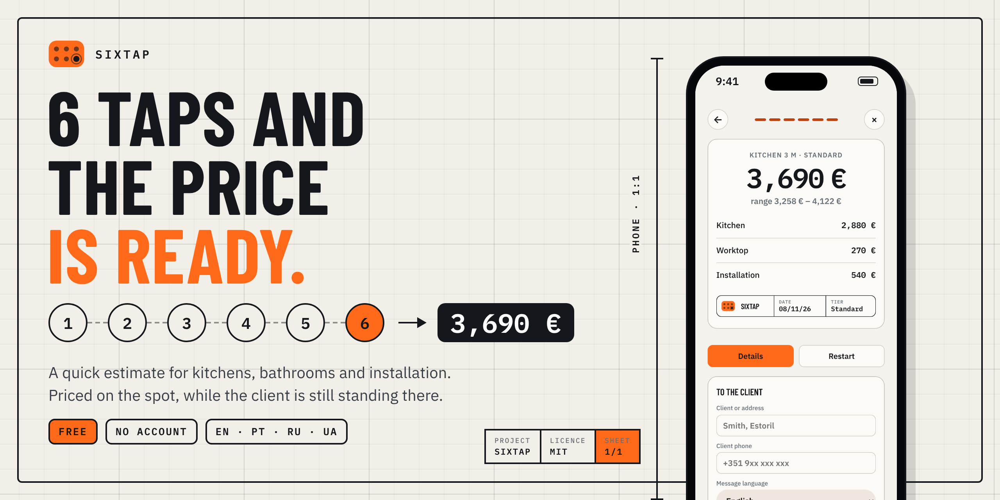
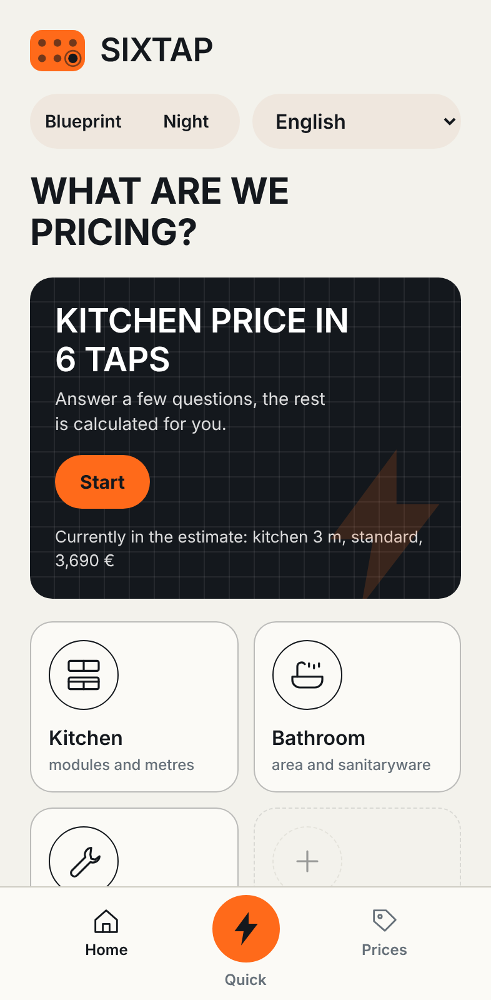
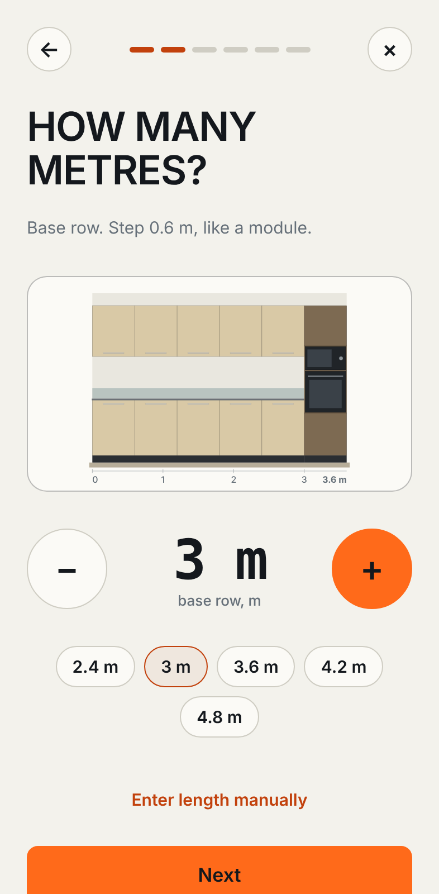
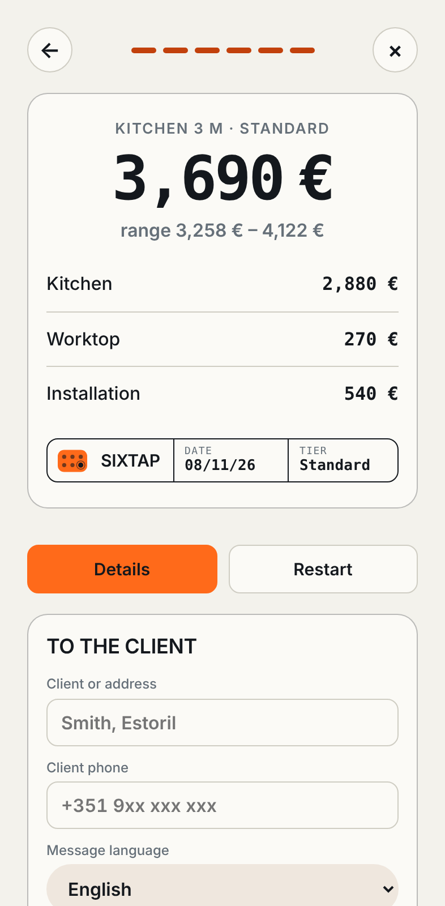
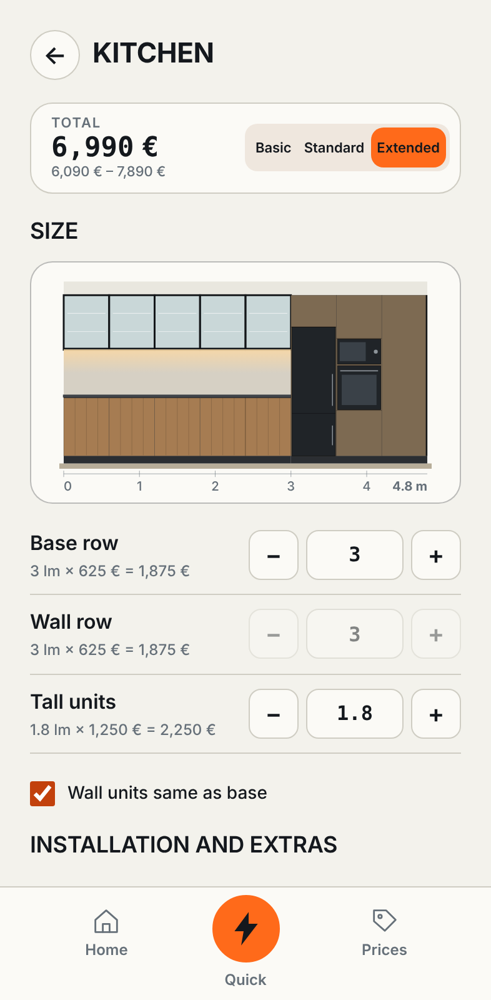
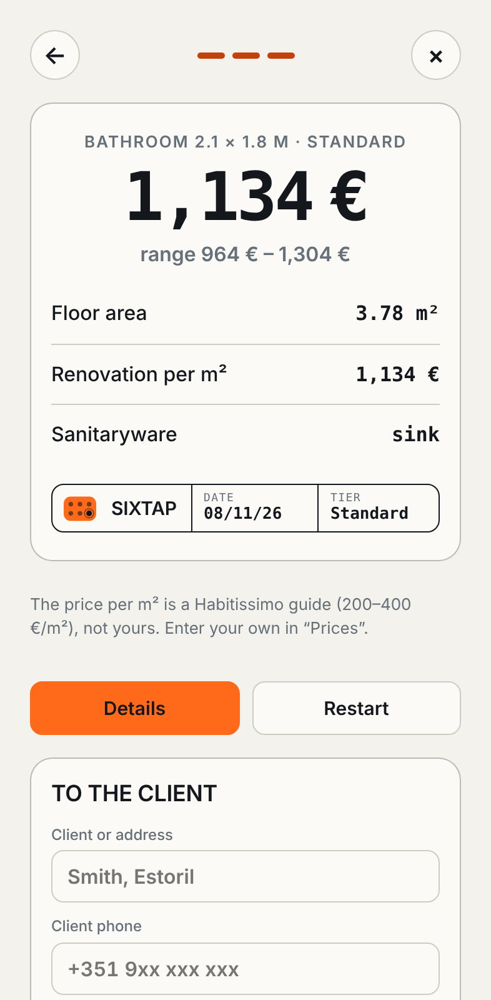
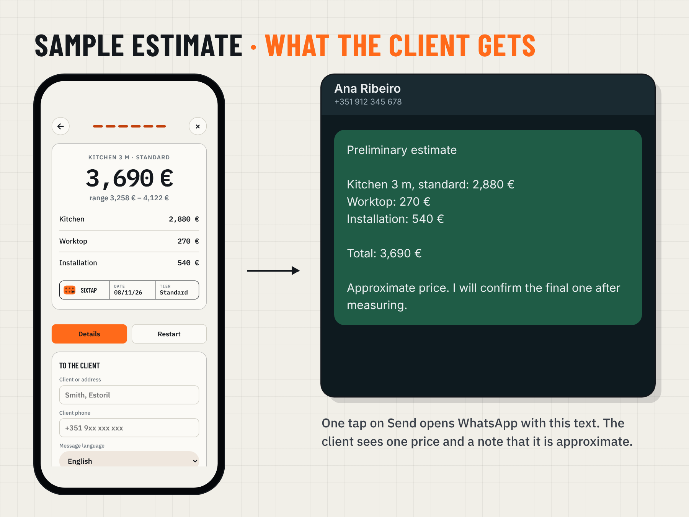

# Sixtap

**6 taps and the price is ready.** Quick estimates for kitchens, bathrooms and installation.

Pick the tier, set the length, get a price with a range. A message with the number goes to the client on WhatsApp while you're still standing in the kitchen. Free, no account.

**[Open the app →](https://davydmedvedchuk.github.io/sixtap/)** · **[Sample estimate](docs/sample-estimate.png)**

## Why

On site the client asks "so how much?" and you don't want to say "I'll send it tomorrow". A spreadsheet is slow on a phone, and a gut-feel number is hard to defend later.

Sixtap asks one question per screen and gives an honest rough price on the spot. Then you measure properly and send the real quote.

## What it does

- **Kitchen.** Six taps: tier, length, wall units, tall units, worktop, installation. Priced per linear metre. A live elevation drawing changes with the tier (Basic, Standard, Extended).
- **Bathroom.** Three taps. Per m² of floor plus fixtures.
- **Installation.** A pick-and-count list.
- **Your prices first.** Enter your own rates on first launch, or skip and fix them later. The defaults are rough guide numbers, not market truth.
- **A message for the client.** Name, phone, one price and a note that it is approximate. Send it to WhatsApp or copy it. Written in Russian, Ukrainian, English or Portuguese.
- **Saved estimates.** Reopen, edit, delete.
- **Four languages in the app.** It picks yours from the phone and remembers the choice.
- **Light and dark.** Same design, two brightness levels.

| Home | Length | Result | Kitchen | Bathroom |
|---|---|---|---|---|
|  |  |  |  |  |

### What your client gets

## How accurate is it

Roughly 15–20 %. It is a conversation tool, not a quote. The kitchen range shows ±15 % by default, and the message to the client says the price is approximate.

The tier prices come from public Portuguese guide figures (Habitissimo, Zaask). Check them against your own jobs before you rely on them.

## How it works

One `index.html`. No framework, no backend, no build step.

- **Storage:** your prices and saved estimates stay in the browser (`localStorage`). Nothing is sent anywhere.
- **Drawing:** the kitchen elevation is SVG, drawn from your numbers.
- **Fonts:** Barlow Condensed and IBM Plex, from Google Fonts.
- **Hosting:** GitHub Pages. Free.

## Install on your phone

1. Open the app link above.
2. **iPhone:** Safari → Share → Add to Home Screen.
   **Android:** Chrome → ⋮ → Add to Home screen.
3. Open it from the icon.

## Good to know

- Data lives only in the browser you used. Another phone or browser starts empty.
- It needs internet for the fonts on first load.

## Credits

Made by Davyd Medvedchuk.

## License

[MIT](LICENSE).
